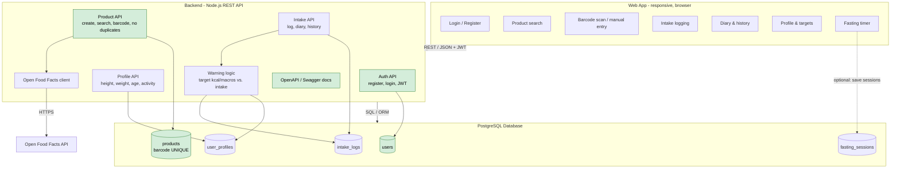

# Architecture – Commit to Fit

Web-based, responsive app (runs in the mobile browser). It talks to a
JavaScript (Node.js) backend via REST/JSON. Data is stored in PostgreSQL.
Product data can also come from Open Food Facts. The Sprint 2 scope is
highlighted in green.

## Notes
- **Multi-device:** The state lives on the server (JWT per device), so one account can be used on several devices.
- **Shared products:** `products` is global, and `barcode` is unique, so duplicates return `409`.
- **Warnings:** The backend computes the daily target from the profile (formula still open with the PO) and compares it with the sum of `intake_logs`.
- **Fasting timer:** It runs in the client. Saving sessions in `fasting_sessions` is optional, pending the PO answer.
- **Sprint 2 scope:** Auth, Product API, DB schema (`users`, `products`) and the OpenAPI docs.
