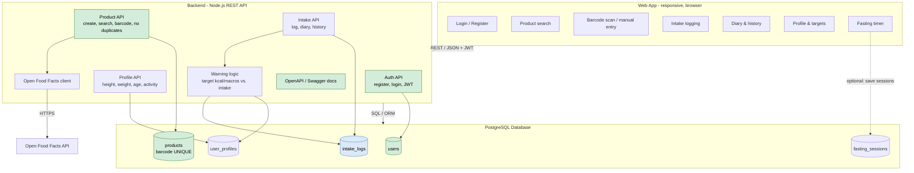

# Architecture – Commit to Fit

Web-based, responsive app (runs in the mobile browser). It talks to a
JavaScript (Node.js) backend via REST/JSON. Data is stored in PostgreSQL.
Product data can also come from Open Food Facts. The Sprint 2 scope is
highlighted in green.

## Notes
- **Multi-device:** The state lives on the server (JWT per device), so one account can be used on several devices.
- **Shared products:** `products` is global, and `barcode` is unique, so duplicates return `409`.
- **Warnings:** The backend computes the daily target from the profile (formula still open with the PO) and compares it with the sum of `intake_logs`.
- **Fasting timer:** It runs in the client. Saving sessions in `fasting_sessions` is optional, pending the PO answer.
- **Sprint 2 scope:** Auth, Product API, DB schema (`users`, `products`) and the OpenAPI docs.
- **Sprint 3 scope (database):** meal per diary entry, diary views and queries, product source for Open Food Facts (blue in the diagram).

## Data model (status Sprint 3)

| Table / view | Columns | Notes |
|---|---|---|
| `users` | id, email, password_hash, created_at | email unique (case-insensitive) |
| `products` | id, barcode, name, brand, kcal, protein, carbs, fat, **source**, **external_id**, created_by, created_at | values per 100 g; barcode UNIQUE; `source` = `manual` or `openfoodfacts`; (source, external_id) unique |
| `intake_logs` | id, user_id, product_id, amount_g, **meal**, consumed_at, created_at | `meal` = breakfast / lunch / dinner / snack (default snack) |
| view `intake_entries` | entry + product name/brand, `day`, kcal, protein, carbs, fat | nutrients = value per 100 g × amount_g / 100 |
| view `daily_intake_totals` | user_id, day, entries, kcal, protein, carbs, fat | one row per user and day |

### Design decisions for the diary (T049)
- **Meal on the entry:** the frontend groups the diary by meal, so `intake_logs.meal` stores it (migration `1794336000000`).
- **Calculated, not stored:** kcal and macros of an entry are calculated in the view from the product values. If a product is corrected, the diary stays consistent.
- **Day = calendar day in Vienna:** `consumed_at` is `TIMESTAMPTZ`; the day is `consumed_at AT TIME ZONE 'Europe/Vienna'`. Queries for one day use a time range on `consumed_at`, so the existing index `(user_id, consumed_at)` is used.
- **Owner only:** every query filters by `user_id`; users never see or delete entries of others.

### Diary queries (`backend/src/repositories/diary.js`, T050)
| Function | Purpose |
|---|---|
| `addEntry(userId, { productId, amountG, meal, consumedAt })` | add an entry, returns it with calculated nutrients |
| `getEntriesForDay(userId, 'YYYY-MM-DD')` | entries of one day, ordered by time |
| `getDailyTotals(userId, 'YYYY-MM-DD')` | sums of one day (zeros if empty) |
| `getTotalsForRange(userId, from, to)` | sums per day for the history |
| `getDiary(userId, 'YYYY-MM-DD')` | day totals + entries grouped by meal |
| `deleteEntry(userId, entryId)` | delete own entry |

These functions are the basis for the REST endpoints of the diary (T054). Errors carry a `statusCode` (400/404), which the central error handler returns.

Tests: `backend/tests/diary.test.js` (T052). Demo data: `npm run seed` adds a 7-day diary for `demo@commit2fit.test` (T058).
